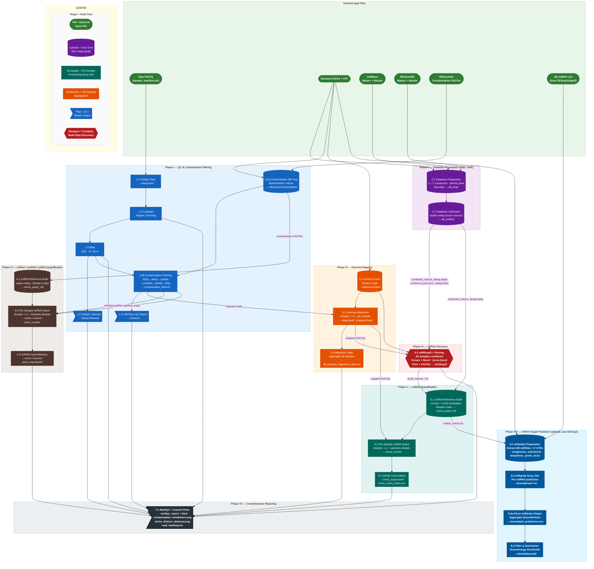

# sRNAstream: small RNA Analysis Pipeline

A comprehensive, species-agnostic pipeline for small RNA sequencing analysis with focus on microRNA discovery and quantification. Designed for SLURM-based HPC environments.

## Overview

This pipeline performs complete analysis of small RNA-seq data from raw reads to count matrices ready for differential expression analysis, including novel miRNA discovery. Each script is self-contained with embedded configuration and generates statistics reports.

---

## Pipeline Workflow

The diagram below shows all pipeline phases, the key input files each step requires, and where outputs from one step feed into another.

```
INPUT FILES REQUIRED BEFORE STARTING
══════════════════════════════════════════════════════════════════════════════
  Raw FASTQ files         → sample_manifest.txt (tab-sep: sample | path)
  Ensembl genome FASTA    → genome.fa
  Ensembl GTF annotation  → annotation.gtf
  miRBase mature FASTA    → reference/mirbase/mature.fa
  miRBase hairpin FASTA   → reference/mirbase/hairpin.fa
  MirGeneDB mature FASTA  → reference/mirgenedb/mirgenedb_mature.fa
  MirGeneDB hairpin FASTA → reference/mirgenedb/mirgenedb_hairpin.fa
  RNAcentral FASTA files  → reference/contamination/  (per RNA type)
══════════════════════════════════════════════════════════════════════════════

┌──────────────────────────────────────────────────────────────────────────────┐
│ Phase I: Quality Control & Contamination Filtering                          │
├──────────────────────────────────────────────────────────────────────────────┤
│                                                                              │
│  INPUT: Raw FASTQ (via sample_manifest.txt)                                 │
│                                                                              │
│  1.1 FastQC (Raw)                                                            │
│      └─ Raw FASTQ → fastqc/raw/*.html, *.zip                                │
│                                                                              │
│  1.2 Adapter Trimming (Cutadapt)                                            │
│      └─ Raw FASTQ → cutadapt/${SAMPLE}_cutadapt.fq.gz                      │
│                      cutadapt/${SAMPLE}_cutadapt.log                        │
│                                                                              │
│  1.3 Quality Filtering (fastp, Q30, length 17–30 nt)                       │
│      ← cutadapt/${SAMPLE}_cutadapt.fq.gz                                   │
│      └─ fastp/${SAMPLE}_trimmed.fq.gz                                       │
│         fastp/${SAMPLE}_fastp.json  (read counts)                           │
│         fastp/${SAMPLE}_fastp.html                                           │
│                                                                              │
│  1.4 FastQC (Cleaned)                                                       │
│      ← fastp/${SAMPLE}_trimmed.fq.gz                                        │
│      └─ fastqc/cleaned/*.html, *.zip                                        │
│                                                                              │
│  1.5a Contamination DB Preparation  [ONE-TIME SETUP]                        │
│      ← Ensembl GTF + RNAcentral FASTA files                                 │
│      └─ reference/contamination/*_index.*  (Bowtie1 indices per RNA type)  │
│                                                                              │
│  1.5b Contamination Filtering  [per-sample array job]                       │
│      ← fastp/${SAMPLE}_trimmed.fq.gz                                        │
│      ← reference/contamination/ (rRNA, tRNA, snRNA, snoRNA, piRNA indices) │
│      └─ contamination_filtered/${SAMPLE}_cleaned.fq.gz  ──► to Phase III   │
│         contamination_filtered/${SAMPLE}_contamination_stats.txt            │
│         snrna_snorna_reads/${SAMPLE}_snrna_reads.fq  ──────────────────────┐│
│         snrna_snorna_reads/${SAMPLE}_snorna_reads.fq  ─────────────────────┤│
│         pirna_reads/${SAMPLE}_pirna_reads.fq  ─────────────────────────────┘│
│                                                                     (→ Ph VI)│
│  1.6 QC Reports (miRTrace + contamination summary)                          │
│      ← contamination_filtered/*_cleaned.fq.gz                              │
│      └─ mirtrace/mirtrace-report.html                                       │
│         mirtrace/mirtrace_stats_summary.txt                                 │
│                                                                              │
└──────────────────────────────────────────────────────────────────────────────┘
                                    ↓
┌──────────────────────────────────────────────────────────────────────────────┐
│ Phase II: Database Preparation  [ONE-TIME SETUP — parallel with Phase I]    │
├──────────────────────────────────────────────────────────────────────────────┤
│                                                                              │
│  INPUT: Ensembl GTF, genome FASTA, miRBase mature/hairpin,                  │
│         MirGeneDB mature/hairpin, RNAcentral miRNA FASTA                    │
│                                                                              │
│  2.1 Database Preparation                                                    │
│      └─ reference/db_prep/ensembl_mirna_mature.fa                           │
│         reference/db_prep/ensembl_mirna_precursor.fa                        │
│         reference/db_prep/mirbase_mature_dna.fa   (U→T converted)          │
│         reference/db_prep/mirbase_hairpin_dna.fa  (U→T converted)          │
│         reference/db_prep/mirgenedb_mature_dna.fa (U→T converted)          │
│         reference/db_prep/mirgenedb_hairpin_dna.fa (U→T converted)         │
│         reference/db_prep/rnacentral_mirna_dna.fa (U→T converted)          │
│         reference/db_prep/length_density_*.png                              │
│         reference/db_prep/duplication_stats_*.txt                           │
│                                                                              │
│  2.2 Database Unification  [extends 2.1 output; runs after 2.1]            │
│      ← reference/db_prep/ FASTA files from 2.1                             │
│      └─ reference/db_unified/combined_mature_dedup.fasta  (merged, deduped)│
│         reference/db_unified/combined_precursor_dedup.fasta                 │
│         reference/db_unified/db_unification_summary.txt                    │
│                                                                              │
└──────────────────────────────────────────────────────────────────────────────┘
                                    ↓
┌──────────────────────────────────────────────────────────────────────────────┐
│ Phase III: Genome Mapping                                                    │
├──────────────────────────────────────────────────────────────────────────────┤
│                                                                              │
│  3.1 Genome Index  [ONE-TIME SETUP]                                         │
│      ← Ensembl genome FASTA (genome.fa)                                     │
│      └─ reference/index/genome.*  (Bowtie1 index)                          │
│                                                                              │
│  3.2 Genome Alignment  [per-sample array job]                               │
│      ← contamination_filtered/${SAMPLE}_cleaned.fq.gz  (from 1.5b)         │
│      ← reference/index/  (from 3.1)                                        │
│      └─ alignment/${SAMPLE}_mapped.fastq  ──────────────────────────────────┐
│         alignment/${SAMPLE}_alignment.log                          (→ Ph IV) │
│         alignment/${SAMPLE}_alignment_stats.txt                             │
│                                                                              │
│  3.3 Alignment Stats Aggregation  [single job; after all 3.2 tasks finish] │
│      ← alignment/*_alignment.log                                            │
│      └─ alignment/all_samples_alignment_stats.tsv                           │
│                                                                              │
└──────────────────────────────────────────────────────────────────────────────┘
                                    ↓
┌──────────────────────────────────────────────────────────────────────────────┐
│ Phase IV: miRDeep2 – Novel and Known miRNA Discovery                        │
├──────────────────────────────────────────────────────────────────────────────┤
│                                                                              │
│  INPUT: Genome-mapped reads from ALL samples (3.2)                         │
│         Known miRNA FASTAs from Phase II (miRBase, MirGeneDB, Ensembl)     │
│                                                                              │
│  4.1 miRDeep2 Analysis + Parsing  [all samples combined]                   │
│      ← alignment/*_mapped.fastq  (from 3.2, all samples)                   │
│      ← reference/db_unified/combined_mature_dedup.fasta (from 2.2)         │
│      ← reference/db_unified/combined_precursor_dedup.fasta (from 2.2)      │
│      ← reference/index/  (from 3.1)                                        │
│      └─ mirdeep2/combined_reads.fasta                                       │
│         mirdeep2/collapsed_reads.fasta                                      │
│         mirdeep2/combined_mapped.arf                                        │
│         mirdeep2/result_*.csv                                               │
│         mirdeep2/parsed/mirdeep2_all.tsv  ──────────────────────────────────┐
│         mirdeep2/parsed/mirdeep2_known.tsv                         (→ Ph V) │
│         mirdeep2/parsed/mirdeep2_novel.tsv                                  │
│         mirdeep2/parsed/mirdeep2_high_conf.tsv                              │
│         mirdeep2/parsed/mirdeep2_parsing_stats.txt                          │
│         mirdeep2/parsed/mirdeep2_summary_stats.tsv                          │
│         mirdeep2/sequences{N}/novel_mature_*.fa  ─────────────────(→ Ph V) │
│         mirdeep2/sequences{N}/novel_precursor_*.fa                          │
│                                                                              │
└──────────────────────────────────────────────────────────────────────────────┘
                                    ↓
┌──────────────────────────────────────────────────────────────────────────────┐
│ Phase V: miRNA Quantification                                                │
├──────────────────────────────────────────────────────────────────────────────┤
│                                                                              │
│  5.1 miRNA Reference Build  [one-time after 4.1]                            │
│      ← reference/db_unified/combined_mature_dedup.fasta (miRBase, MirGeneDB)│
│      ← mirdeep2/sequences{N}/novel_mature_*.fa (from 4.1, user threshold)  │
│      └─ reference/mirna_quant_ref/unified_mature.fa  ─────────────────────┐ │
│         reference/mirna_quant_ref/unified_mature_index.*  (Bowtie1 index) │ │
│         reference/mirna_quant_ref/deduplication_report.txt                │ │
│                                                                            ↓ │
│  5.2 Per-Sample miRNA Quantification  [per-sample array job]               │
│      ← alignment/${SAMPLE}_mapped.fastq  (from 3.2)                        │
│      ← reference/mirna_quant_ref/unified_mature_index.*  (from 5.1)        │
│      └─ mirna_counts/${SAMPLE}_mirna_counts.txt  (idxstats format)         │
│         mirna_counts/${SAMPLE}_mirna_stats.txt                              │
│         mirna_counts/${SAMPLE}_mirna.bam                                    │
│                                                                              │
│  5.3 miRNA Count Matrix  [all samples; after 5.2]                           │
│      ← mirna_counts/*_mirna_counts.txt  (from 5.2, all samples)            │
│      └─ mirna_expression/mirna_count_matrix.tsv  (DESeq2-ready)            │
│         mirna_expression/mirna_cpm_normalized.tsv                           │
│         mirna_expression/mirna_log2cpm_normalized.tsv                       │
│         mirna_expression/mirna_gene_summary.tsv                             │
│         mirna_expression/mirna_expression_stats.txt                         │
│                                                                              │
└──────────────────────────────────────────────────────────────────────────────┘
                                    ↓
┌──────────────────────────────────────────────────────────────────────────────┐
│ Phase VI: snRNA / snoRNA / piRNA Expression Quantification                  │
├──────────────────────────────────────────────────────────────────────────────┤
│                                                                              │
│  INPUT: Reads captured during contamination filtering (Phase I.5b)          │
│         Bowtie1 indices built from the same contamination reference          │
│                                                                              │
│  6.1 snRNA/snoRNA/piRNA Reference Build  [ONE-TIME SETUP]                  │
│      ← reference/contamination/snrna_index_sequences.fa  (from 1.5a)       │
│      ← reference/contamination/snorna_index_sequences.fa (from 1.5a)       │
│      ← reference/contamination/pirna_index_sequences.fa  (from 1.5a)       │
│      └─ reference/snrna_quant_ref/snrna_dedup.fa + snrna_index.*           │
│         reference/snrna_quant_ref/snorna_dedup.fa + snorna_index.*          │
│         reference/snrna_quant_ref/pirna_dedup.fa + pirna_index.*            │
│         reference/snrna_quant_ref/deduplication_report.txt                  │
│                                                                              │
│  6.2 Per-Sample Quantification  [per-sample array job]                      │
│      ← snrna_snorna_reads/${SAMPLE}_snrna_reads.fq  (from 1.5b)            │
│      ← snrna_snorna_reads/${SAMPLE}_snorna_reads.fq (from 1.5b)            │
│      ← pirna_reads/${SAMPLE}_pirna_reads.fq         (from 1.5b)            │
│      ← reference/snrna_quant_ref/*_index.*           (from 6.1)            │
│      └─ snrna_counts/${SAMPLE}_snrna_counts.txt  (idxstats format)         │
│         snrna_counts/${SAMPLE}_snrna_stats.txt                              │
│         snorna_counts/${SAMPLE}_snorna_counts.txt                           │
│         snorna_counts/${SAMPLE}_snorna_stats.txt                            │
│         pirna_counts/${SAMPLE}_pirna_counts.txt                             │
│         pirna_counts/${SAMPLE}_pirna_stats.txt                              │
│                                                                              │
│  6.3 Count Matrices  [all samples; after 6.2]                              │
│      ← snrna_counts/*, snorna_counts/*, pirna_counts/*  (from 6.2)         │
│      └─ snrna_expression/snrna_count_matrix.tsv  (DESeq2-ready)            │
│         snrna_expression/snrna_cpm_normalized.tsv                           │
│         snrna_expression/snrna_log2cpm_normalized.tsv                       │
│         snorna_expression/snorna_count_matrix.tsv                           │
│         snorna_expression/snorna_cpm_normalized.tsv                         │
│         snorna_expression/snorna_log2cpm_normalized.tsv                     │
│         pirna_expression/pirna_count_matrix.tsv                             │
│         pirna_expression/pirna_cpm_normalized.tsv                           │
│         pirna_expression/pirna_log2cpm_normalized.tsv                       │
│                                                                              │
└──────────────────────────────────────────────────────────────────────────────┘
                                    ↓
┌──────────────────────────────────────────────────────────────────────────────┐
│ Phase VII: Comprehensive Reporting                                           │
├──────────────────────────────────────────────────────────────────────────────┤
│                                                                              │
│  7.1 MultiQC & Custom Report  [run after all phases complete]               │
│      ← All results/ subdirectories (MultiQC auto-discovery)                 │
│      ← sample_manifest.txt                                                  │
│      └─ multiqc/multiqc_report_YYYYMMDD_HHMM.html  (FastQC, Cutadapt, fastp, …)│
│         multiqc/read_tracking.tsv                                            │
│         multiqc/contamination_breakdown.png                                  │
│         multiqc/mirdeep2_known_novel.png                                     │
│         multiqc/mirna_distinct_detected.png                                  │
│         multiqc/snrna_distinct_detected.png                                  │
│         multiqc/snorna_distinct_detected.png                                 │
│         multiqc/pirna_distinct_detected.png                                  │
│         multiqc/pipeline_summary.txt                                         │
│                                                                              │
└──────────────────────────────────────────────────────────────────────────────┘
                      ✓ Ready for Differential Expression Analysis
                      ↓ (after DESeq2 / edgeR — produce DE miRNA list)
┌──────────────────────────────────────────────────────────────────────────────┐
│ Phase VIII: miRNA Target Prediction (miRanda)  [OPTIONAL — post-DESeq2]     │
├──────────────────────────────────────────────────────────────────────────────┤
│                                                                              │
│  INPUT: DE miRNA list from DESeq2/edgeR analysis (one miRNA name per line)  │
│         Unified mature miRNA FASTA (from 5.1_mirna_reference.sh)            │
│         Ensembl genome FASTA + GTF annotation                               │
│                                                                              │
│  ⚠  PREREQUISITE: Run differential expression analysis (e.g. DESeq2) on    │
│     the count matrix from Phase V first.  Provide the resulting list of     │
│     significantly DE miRNA names as MIRNA_LIST in 8.1.                      │
│                                                                              │
│  8.1 miRanda Preparation  [ONE-TIME per analysis]                           │
│      ← DE miRNA list (MIRNA_LIST, one name per line)                        │
│      ← reference/mirna_quant_ref/unified_mature.fa  (from 5.1)             │
│      ← Ensembl genome FASTA + GTF (3' UTR extraction)                      │
│      └─ temp/mirna_selected.fa        – selected DE miRNA sequences         │
│         temp/mirna_list_indexed.txt   – indexed list for array job          │
│         temp/three_prime_utr.bed      – 3' UTR BED coordinates              │
│         temp/three_prime_utr.fa       – 3' UTR sequences (uppercase DNA)   │
│                                                                              │
│  8.2 miRanda Array Job  [per-miRNA SLURM array job]                         │
│      ← temp/mirna_selected.fa + temp/three_prime_utr.fa  (from 8.1)        │
│      └─ miranda/raw/<miRNA>.txt  – raw miRanda output per miRNA             │
│                                                                              │
│  8.2a Parse miRanda Output  [after all 8.2 tasks complete]                  │
│      ← miranda/raw/*.txt  (from 8.2, all miRNAs)                            │
│      └─ miranda/all_predictions.tsv             – consolidated predictions  │
│         miranda/target_prediction_statistics.txt – summary statistics       │
│                                                                              │
│  8.3 Filter & Summarise  [after 8.2a]                                       │
│      ← miranda/all_predictions.tsv  (from 8.2a)                            │
│      └─ miranda/parsed/filtered_predictions.tsv  – score/energy filtered   │
│         miranda/parsed/mirna_target_summary.tsv  – filtered target counts  │
│         miranda/parsed/mirna_gene_summary.tsv    – per-miRNA gene list      │
│                                                                              │
└──────────────────────────────────────────────────────────────────────────────┘
```

---

## Mermaid Pipeline Flow Diagram



> **Shape key** — 🟢 **Pill** (`([…])`): external input data file; 🔵 **Cylinder** (`[(…)]`): one-time reference / index building step; ▭ **Rectangle** (`[…]`): per-sample processing (SLURM array job); ▣ **Double-box** (`[[…]]`): cross-sample aggregation producing final matrices; ➤ **Flag** (`>…]`): QC check or report deliverable; ⬡ **Hexagon** (`{{…}}`): complex multi-input discovery analysis.

---

## Features

✅ **Database Files Preparation**: Extract Ensembl miRNA sequences, convert U→T for miRBase/MirGeneDB/RNAcentral, density plots, and duplication statistics  
✅ **Sequential Contamination Filtering**: rRNA → tRNA → snRNA → snoRNA → piRNA → other small RNA  
✅ **Species-Agnostic**: Configurable for any organism with Ensembl reference  
✅ **Complete QC Pipeline**: FastQC, miRTrace, MultiQC with embedded statistics  
✅ **Adapter Trimming**: Supports all common small RNA kit adapters (Cutadapt + fastp)  
✅ **Combined miRDeep2**: All samples pooled for maximum sensitivity in known + novel miRNA detection  
✅ **miRDeep2 Parsing**: Score-threshold filtering, per-tier TSV tables, mature/precursor FASTA extraction  
✅ **Unified miRNA Reference**: Deduplicated reference from miRDeep2 + miRBase + MirGeneDB + Ensembl  
✅ **miRNA Quantification**: Per-sample Bowtie1 mapping + samtools idxstats gene counting  
✅ **DESeq2-Ready Matrices**: Integer count matrix + CPM + log2CPM for miRNA, snRNA, snoRNA, and piRNA  
✅ **snRNA/snoRNA/piRNA Quantification**: Recovered reads re-mapped against per-type Bowtie1 indices  
✅ **Comprehensive Reporting**: MultiQC + read-tracking stacked bars + mapping rate charts + distinct species plots  
✅ **Statistics Reports**: Embedded Python stats in each applicable step  
✅ **miRNA Target Prediction**: miRanda-based 3' UTR target scanning for differentially expressed miRNAs (Phase VIII)

---

## Requirements

- SLURM workload manager
- Anaconda/Miniconda
- Reference genome FASTA (from Ensembl)
- GTF annotation file (from Ensembl)
- Pre-downloaded miRBase, MirGeneDB, and contamination reference files (see Installation)

---

## Installation

### 1. Clone Repository

```bash
git clone https://github.com/AHinsu/bovine-microRNA.git
cd bovine-microRNA
```

### 2. Create Conda Environment

```bash
conda env create -f environment.yml
conda activate smallRNA
```

### 3. Prepare Reference Files

#### Ensembl Reference (download on any machine with internet access)

```bash
mkdir -p /path/to/reference
cd /path/to/reference

# Download genome FASTA (example: Bos taurus)
wget http://ftp.ensembl.org/pub/current_fasta/bos_taurus/dna/Bos_taurus.ARS-UCD1.2.dna.toplevel.fa.gz
gunzip Bos_taurus.ARS-UCD1.2.dna.toplevel.fa.gz
mv Bos_taurus.ARS-UCD1.2.dna.toplevel.fa genome.fa

# Download GTF annotation
wget http://ftp.ensembl.org/pub/current_gtf/bos_taurus/Bos_taurus.ARS-UCD1.2.111.gtf.gz
gunzip Bos_taurus.ARS-UCD1.2.111.gtf.gz
mv Bos_taurus.ARS-UCD1.2.111.gtf annotation.gtf
```

For other species, replace the species name in the Ensembl URL accordingly.

#### External miRNA Databases (REQUIRED for Phase II)

**IMPORTANT**: Download on a machine with internet access and transfer to your reference directory.

##### MirGeneDB (Most stringently curated)

> URL: https://mirgenedb.org/  (Latest Release: v3.0)
> Rationale: Evolutionarily validated, lowest false-positive rate

```bash
mkdir -p /path/to/reference/mirgenedb

# Mature miRNA sequences (all species)
wget -O /path/to/reference/mirgenedb/mirgenedb_mature.fa 'https://mirgenedb.org/fasta/all?mat=1'

# Hairpin/precursor sequences (all species)
wget -O /path/to/reference/mirgenedb/mirgenedb_hairpin.fa 'https://mirgenedb.org/fasta/all?pre=1'
```

##### miRBase (Comprehensive reference)

> URL: https://www.mirbase.org/ (Latest release: v22.1)  
> Rationale: Most widely used, largest collection

```bash
mkdir -p /path/to/reference/mirbase

wget https://www.mirbase.org/download/mature.fa.gz && gunzip mature.fa.gz
wget https://www.mirbase.org/download/hairpin.fa.gz && gunzip hairpin.fa.gz
mv mature.fa hairpin.fa /path/to/reference/mirbase/
```

#### Contamination Reference Libraries (REQUIRED for Phase I)

All user-provided FASTA files are extracted from the **RNAcentral** database using
the SQL queries and helper scripts in the `referenceDownload/` folder.
See `referenceDownload/README.md` for full step-by-step instructions.

The Ensembl GTF (downloaded above) is used automatically by `1.5a` to extract
sequences by `gene_biotype`. User-provided RNAcentral FASTA files supplement the
GTF and are recommended for more comprehensive coverage.

RNA types to extract from RNAcentral for contamination filtering:

- **rRNA** – query RNAcentral with RNA type `rRNA` for your species taxid
- **tRNA** – query RNAcentral with RNA type `tRNA`
- **snRNA** – query RNAcentral with RNA type `snRNA` (reads saved for Phase VI)
- **snoRNA** – query RNAcentral with RNA type `snoRNA` (reads saved for Phase VI)
- **piRNA** – query RNAcentral with RNA type `piRNA` (reads saved for Phase VI)
- **Other** (misc_RNA, Y_RNA, vault_RNA, ribozyme) – query with the relevant RNA types

Set the paths to the extracted FASTA files in the `USER_*_FA` variables in
`1.5a_contamination_db_preparation.sh`. Bowtie indices are built automatically.

#### Supplementary snRNA/snoRNA/piRNA Reference Sequences for Phase VI (optional)

By default Phase VI.1 (`6.1_snrna_snorna_reference.sh`) builds Bowtie1 indices
directly from the FASTA files that `1.5a_contamination_db_preparation.sh` produced for
each RNA type (snRNA, snoRNA, piRNA), deduplicated with **seqkit rmdup**.  No external
database or BED/BLAST integration is required.

---

## Configuration

Each script has a **USER CONFIGURATION** section at the top. Edit these variables before running:

| Variable | Description |
|----------|-------------|
| `OUTDIR` | Output directory path (consistent across all scripts) |
| `REF_DIR` | Reference directory path |
| `GENOME_FASTA` | Path to Ensembl genome FASTA |
| `GTF_FILE` | Path to Ensembl GTF annotation |
| `MANIFEST` | Sample manifest file path |
| `CONDA_ENV` | Conda environment name (default: `smallRNA`) |
| `SPECIES_PREFIX` | 3-letter species code (e.g., `bta`, `hsa`, `mmu`) |

### Sample Manifest

Create a **tab-separated** sample manifest file with a header row:

```
sample_name	fastq_path
Sample01	/path/to/RawData/Sample01.fq.gz
Sample02	/path/to/RawData/Sample02.fq.gz
Sample03	/path/to/RawData/Sample03.fq.gz
```

**Important**: All per-sample scripts use this manifest for SLURM array job processing. Update the `MANIFEST` variable in each script to point to your file.

---

## Usage

### Execution Order

Scripts must be executed in the order shown below. Phase II (database preparation) can be run in parallel with Phase I.

#### Phase I: Quality Control & Contamination Filtering
```bash
sbatch scripts/1.1_fastqc_raw.sh					# (array job, per-sample)
sbatch scripts/1.2_adapter_trimming.sh            # after 1.1 (array job, per-sample)
sbatch scripts/1.3_quality_filtering.sh            # after 1.2 (array job, per-sample)
sbatch scripts/1.4_fastqc_cleaned.sh              # after 1.3 (array job, per-sample)
sbatch scripts/1.5a_contamination_db_preparation.sh  # ONE-TIME: after 1.3
sbatch scripts/1.5b_contamination_filtering.sh    # after 1.5a (array job, per-sample)
sbatch scripts/1.6_qc_reports.sh                  # after 1.5b
```

#### Phase II: Database Files Preparation (ONE-TIME — can run in parallel with Phase I)
```bash
sbatch scripts/2.1_database_preparation.sh
sbatch scripts/2.2_database_unification.sh        # after 2.1
```

#### Phase III: Genome Mapping
```bash
sbatch scripts/3.1_genome_index.sh               # ONE-TIME: build Bowtie1 genome index
sbatch scripts/3.2_genome_alignment.sh           # array job, per-sample
sbatch scripts/3.3_alignment_stats.sh            # aggregate stats
```

#### Phase IV: miRDeep2 – Novel and Known miRNA Discovery
```bash
sbatch scripts/4.1_mirdeep2_analysis.sh          # after 3.2 (all samples combined; includes parsing)
```

#### Phase V: miRNA Quantification
```bash
sbatch scripts/5.1_mirna_reference.sh            # after 4.1; merges known + novel at chosen threshold
sbatch scripts/5.2_mirna_quantification.sh       # after 5.1 and 3.2 (array job, per-sample)
sbatch scripts/5.3_count_matrix.sh              # after 5.2 (all samples)
```

#### Phase VI: snRNA/snoRNA/piRNA Expression Quantification
```bash
sbatch scripts/6.1_snrna_snorna_reference.sh     # ONE-TIME: after 1.5a (build per-type indices)
sbatch scripts/6.2_snrna_snorna_quantification.sh  # after 6.1 and 1.5b (array job, per-sample)
sbatch scripts/6.3_count_matrix.sh              # after 6.2 (all samples)
```

#### Phase VII: Comprehensive Reporting
```bash
sbatch scripts/7.1_multiqc_report.sh            # after all phases complete
```

#### Phase VIII: miRNA Target Prediction (OPTIONAL — requires DE miRNA list from DESeq2)
> **Prerequisite**: Run differential expression analysis (e.g. DESeq2 or edgeR) on
> `mirna_expression/mirna_count_matrix.tsv` first.  Create a plain-text file listing
> the names of significantly differentially expressed miRNAs (one per line) and point
> `MIRNA_LIST` in `8.1_mirna_target_preparation.sh` to it.

```bash
sbatch scripts/8.1_mirna_target_preparation.sh  # prepare DE miRNA + 3' UTR files
# Update #SBATCH --array=1-<count> in 8.2_miranda_array.sh, to reflect number of miRNA from 8.1 script
sbatch scripts/8.2_miranda_array.sh				# runs miRanda for each miRNA as array job
sbatch scripts/8.2a_miranda_results_parsed.sh   # Parses miRanda output and compiles all predictions
sbatch scripts/8.3_miranda_results.sh           # filter and summarise (after 8.2a)
```

### Array Job Configuration

Per-sample scripts use SLURM array jobs driven by your manifest file:

```bash
# Count samples in manifest (excluding header)
SAMPLE_COUNT=$(tail -n +2 sample_manifest.txt | wc -l)
# Set #SBATCH --array=1-xxx in each per-sample script , where xxx is the value from SAMPLE_COUNT
```

---

## Output Structure

```
results/
├── fastqc/
│   ├── raw/                                      # Phase 1.1 – Raw QC reports
│   └── cleaned/                                  # Phase 1.4 – Post-trimming QC
│
├── cutadapt/                                      # Phase 1.2
│   ├── ${SAMPLE}_cutadapt.fq.gz                  # Adapter-trimmed reads
│   └── ${SAMPLE}_cutadapt.log                    # Trimming statistics
│
├── fastp/                                         # Phase 1.3
│   ├── ${SAMPLE}_trimmed.fq.gz                   # Quality-filtered reads
│   ├── ${SAMPLE}_fastp.html
│   └── ${SAMPLE}_fastp.json                      # Read counts (used by Phase VII)
│
├── contamination_filtered/                        # Phase 1.5b
│   ├── ${SAMPLE}_cleaned.fq.gz                   # Clean reads → input for Phase III
│   └── ${SAMPLE}_contamination_stats.txt         # Per-sample contamination breakdown
│
├── snrna_snorna_reads/                            # Phase 1.5b (saved for Phase VI)
│   ├── ${SAMPLE}_snrna_reads.fq                  # snRNA-mapped reads
│   └── ${SAMPLE}_snorna_reads.fq                 # snoRNA-mapped reads
│
├── pirna_reads/                                   # Phase 1.5b (saved for Phase VI)
│   └── ${SAMPLE}_pirna_reads.fq                  # piRNA-mapped reads
│
├── mirtrace/                                      # Phase 1.6
│   ├── mirtrace-report.html
│   └── mirtrace_stats_summary.txt
│
├── alignment/                                     # Phase III
│   ├── ${SAMPLE}_mapped.fastq                    # Mapped reads → input for Phases IV & V
│   ├── ${SAMPLE}_alignment.log                   # Bowtie1 alignment log
│   ├── ${SAMPLE}_alignment_stats.txt             # Per-sample mapping stats (from 3.2)
│   └── all_samples_alignment_stats.tsv           # Combined stats table (from 3.3)
│
├── mirdeep2/                                      # Phase IV
│   ├── combined_reads.fasta                      # Concatenated genome-mapped reads (all samples)
│   ├── collapsed_reads.fasta                     # Collapsed reads for miRDeep2
│   ├── combined_mapped.arf                       # miRDeep2 ARF mapping file
│   ├── result_*.csv                              # Raw miRDeep2 output
│   ├── result_*.html                             # miRDeep2 interactive results
│   ├── result_*.bed                              # miRDeep2 BED output
│   ├── miRNAs_expressed_all_samples_*.csv        # miRDeep2 quantification table
│   ├── combined_mirdeep2.log
│   ├── pdfs_*/                                   # miRDeep2 PDF figures (timestamped dir)
│   ├── matured_cleaned.fasta                     # Known mature miRNAs after cleaning
│   ├── precursor_cleaned.fasta                   # Precursor sequences after cleaning
│   └── parsed/                                   # Parsed miRDeep2 predictions (from 4.1)
│       ├── mirdeep2_all.tsv                      # All predictions (annotated)
│       ├── mirdeep2_known.tsv                    # Known miRNA subset
│       ├── mirdeep2_novel.tsv                    # Novel miRNA subset
│       ├── mirdeep2_high_conf.tsv               # High-confidence subset
│       ├── mirdeep2_parsing_stats.txt            # Detailed parsing statistics
│       ├── mirdeep2_summary_stats.tsv            # Tiered scoring summary table
│       └── sequences{score}/                     # Per-score-tier FASTA output (e.g. sequences1/, sequences5/, sequences10/)
│           ├── novel_mature_*.fa                 # Novel mature miRNA sequences
│           ├── known_mature_*.fa                 # Known mature miRNA sequences
│           └── novel_precursor_*.fa             # Novel precursor sequences
│
├── mirna_counts/                                  # Phase V.2
│   ├── ${SAMPLE}_mirna.bam                       # Unsorted BAM (intermediate)
│   ├── ${SAMPLE}_mirna_sorted.bam                # Coordinate-sorted BAM
│   ├── ${SAMPLE}_mirna_sorted.bam.csi            # BAM index
│   ├── ${SAMPLE}_mirna_counts.txt                # Per-sequence read counts (idxstats)
│   ├── ${SAMPLE}_mirna_alignment.log             # Bowtie alignment log
│   ├── ${SAMPLE}_mirna_flagstat.txt              # samtools flagstat
│   └── ${SAMPLE}_mirna_stats.txt                 # Mapping statistics
│
├── mirna_expression/                              # Phase V.3 — FINAL miRNA OUTPUT
│   ├── mirna_count_matrix.tsv                    # Raw counts (DESeq2/edgeR input)
│   ├── mirna_cpm_normalized.tsv                  # For visualisation only
│   ├── mirna_log2cpm_normalized.tsv             # For visualisation only
│   ├── mirna_gene_summary.tsv                    # Per-miRNA statistics
│   ├── mirna_sample_summary.tsv                  # Per-sample mapping statistics
│   └── mirna_expression_stats.txt               # Summary report
│
├── snrna_counts/                                  # Phase VI.2
│   ├── ${SAMPLE}_snrna.bam                       # Unsorted BAM (intermediate)
│   ├── ${SAMPLE}_snrna_sorted.bam                # Coordinate-sorted BAM
│   ├── ${SAMPLE}_snrna_sorted.bam.csi            # BAM index
│   ├── ${SAMPLE}_snrna_counts.txt                # Per-sequence read counts (idxstats)
│   ├── ${SAMPLE}_snrna_alignment.log             # Bowtie alignment log
│   ├── ${SAMPLE}_snrna_flagstat.txt              # samtools flagstat
│   └── ${SAMPLE}_snrna_stats.txt                 # Mapping statistics
│
├── snorna_counts/                                 # Phase VI.2
│   ├── ${SAMPLE}_snorna.bam                      # Unsorted BAM (intermediate)
│   ├── ${SAMPLE}_snorna_sorted.bam               # Coordinate-sorted BAM
│   ├── ${SAMPLE}_snorna_sorted.bam.csi           # BAM index
│   ├── ${SAMPLE}_snorna_counts.txt               # Per-sequence read counts (idxstats)
│   ├── ${SAMPLE}_snorna_alignment.log            # Bowtie alignment log
│   ├── ${SAMPLE}_snorna_flagstat.txt             # samtools flagstat
│   └── ${SAMPLE}_snorna_stats.txt                # Mapping statistics
│
├── pirna_counts/                                  # Phase VI.2
│   ├── ${SAMPLE}_pirna.bam                       # Unsorted BAM (intermediate)
│   ├── ${SAMPLE}_pirna_sorted.bam                # Coordinate-sorted BAM
│   ├── ${SAMPLE}_pirna_sorted.bam.csi            # BAM index
│   ├── ${SAMPLE}_pirna_counts.txt                # Per-sequence read counts (idxstats)
│   ├── ${SAMPLE}_pirna_alignment.log             # Bowtie alignment log
│   ├── ${SAMPLE}_pirna_flagstat.txt              # samtools flagstat
│   └── ${SAMPLE}_pirna_stats.txt                 # Mapping statistics
│
├── snrna_expression/                              # Phase VI.3 — FINAL snRNA OUTPUT
│   ├── snrna_count_matrix.tsv                    # Raw counts (DESeq2/edgeR input)
│   ├── snrna_cpm_normalized.tsv
│   ├── snrna_log2cpm_normalized.tsv
│   ├── snrna_gene_summary.tsv
│   └── snrna_sample_summary.tsv
│
├── snorna_expression/                             # Phase VI.3 — FINAL snoRNA OUTPUT
│   ├── snorna_count_matrix.tsv
│   ├── snorna_cpm_normalized.tsv
│   ├── snorna_log2cpm_normalized.tsv
│   ├── snorna_gene_summary.tsv
│   └── snorna_sample_summary.tsv
│
├── pirna_expression/                              # Phase VI.3 — FINAL piRNA OUTPUT
│   ├── pirna_count_matrix.tsv
│   ├── pirna_cpm_normalized.tsv
│   ├── pirna_log2cpm_normalized.tsv
│   ├── pirna_gene_summary.tsv
│   └── pirna_sample_summary.tsv
│
├── reports/                                       # Phase I summary reports
│   ├── phase1_contamination_summary.tsv          # Per-sample contamination breakdown
│   └── phase1_read_count_summary.tsv             # Per-sample read counts at each filtering step
│
└── multiqc/                                       # Phase VII — REPORT
    ├── multiqc_report_YYYYMMDD_HHMM.html         # MultiQC HTML report (all sections, timestamped)
    ├── contamination_breakdown.png               # Contamination stacked bar (standalone)
    ├── mirdeep2_known_novel.png                  # miRDeep2 known/novel bar chart (standalone)
    ├── mirna_distinct_detected.png               # Distinct miRNA bar chart (standalone)
    ├── snrna_distinct_detected.png               # Distinct snRNA bar chart (standalone)
    ├── snorna_distinct_detected.png              # Distinct snoRNA bar chart (standalone)
    ├── pirna_distinct_detected.png               # Distinct piRNA bar chart (standalone)
    ├── read_tracking.tsv                         # Per-sample read counts at each pipeline stage
    └── pipeline_summary.txt                      # Plain-text summary of all metrics

# Phase VIII outputs (located under the OUTDIR set in 8.1):
targets/miRNA/
├── temp/                                         # Temporary files from 8.1 (removed by 8.2a)
│   ├── mirna_selected.fa                         # Selected DE miRNA sequences (FASTA)
│   ├── mirna_list_indexed.txt                    # Indexed miRNA names (one per line)
│   ├── three_prime_utr.bed                       # 3' UTR coordinates (BED format)
│   └── three_prime_utr.fa                        # 3' UTR sequences (uppercase DNA FASTA)
└── miranda/
    ├── raw/                                      # Per-miRNA raw miRanda output (from 8.2)
    │   └── <miRNA_name>.txt
    ├── all_predictions.tsv                       # Consolidated predictions (miRNA, target, score, energy)
    ├── target_prediction_statistics.txt          # Summary statistics and top miRNAs
    └── parsed/                                   # Filtered results (from 8.3)
        ├── filtered_predictions.tsv              # Predictions passing score/energy thresholds
        ├── mirna_target_summary.tsv              # Filtered per-miRNA target summary
        └── mirna_gene_summary.tsv                # Per-miRNA unique gene list
                                                  # Note: per-miRNA detailed TSV files are not currently generated
```

### Reference Files

```
reference/
├── Bos_taurus.chromsomal.fa           # Ensembl genome FASTA (or symlink)
├── Bos_taurus.cleaned.gtf             # Ensembl GTF annotation (or symlink)
├── index/                             # Phase III.1 output (Bowtie1)
│   └── genome.*
├── db_prep/                           # Phase II.1 output
│   ├── ensembl_mirna.fasta            # Extracted miRNA sequences (DNA) from Ensembl GTF + FASTA
│   ├── mature_dna_<Label>.fasta       # Per-source mature FASTA after U→T conversion
│   ├── precursor_dna_<Label>.fasta    # Per-source precursor FASTA after U→T conversion
│   ├── combined_mature_all.fasta      # All mature sequences merged
│   ├── combined_mature_dedup.fasta    # Merged mature after seqkit rmdup
│   ├── combined_hairpin_all.fasta     # All hairpin sequences merged
│   ├── combined_hairpin_dedup.fasta   # Merged hairpin after seqkit rmdup
│   ├── length_density_*.png           # Density plots per database
│   ├── duplication_stats_mature.txt   # Mature duplication statistics
│   ├── duplication_stats_precursor.txt
│   └── db_preparation_summary.txt
├── db_unified/                        # Phase II.2 output (cross-database unification)
│   ├── combined_mature_all.fasta      # All mature sources concatenated
│   ├── combined_mature_dedup.fasta    # Unified mature miRNA reference (seqkit rmdup)
│   ├── combined_precursor_all.fasta   # All precursor sources concatenated
│   ├── combined_precursor_dedup.fasta # Unified precursor reference (seqkit rmdup)
│   ├── dedup_stats.png                # Before/after dedup bar chart
│   ├── length_density_final.png       # Final unified reference length distribution
│   └── db_unification_summary.txt     # Summary statistics
├── mirna_quant_ref/                   # Phase V.1 output
│   ├── unified_mature_all.fa          # Known + novel combined (pre-dedup)
│   ├── unified_mature.fa              # Deduplicated mature miRNA reference (DNA)
│   ├── unified_mature_index.*         # Bowtie1 index for Phase V.2
│   ├── dup_info.txt                   # seqkit rmdup duplicate info
│   ├── deduplication_report.txt       # Deduplication statistics
│   └── reference_build_summary.txt   # Overall summary
├── snrna_quant_ref/                   # Phase VI.1 output
│   ├── snrna_dedup.fa                 # Deduplicated snRNA sequences (DNA)
│   ├── snrna_index.*                  # Bowtie1 index for snRNA
│   ├── snorna_dedup.fa                # Deduplicated snoRNA sequences (DNA)
│   ├── snorna_index.*                 # Bowtie1 index for snoRNA
│   ├── pirna_dedup.fa                 # Deduplicated piRNA sequences (DNA)
│   ├── pirna_index.*                  # Bowtie1 index for piRNA
│   ├── deduplication_report.txt       # Per-type duplicate statistics
│   └── reference_build_summary.txt   # Overall summary
├── mirbase/
│   ├── mature.fa                      # Full miRBase mature FASTA (all species)
│   ├── hairpin.fa                     # Full miRBase hairpin FASTA (all species)
│   ├── bta_mature.fa                  # Species-filtered mature FASTA (Bos taurus)
│   └── bta_hairpin.fa                 # Species-filtered hairpin FASTA (Bos taurus)
├── mirgenedb/
│   ├── mirgenedb_mature.fa            # MirGeneDB mature FASTA (all species)
│   ├── mirgenedb_hairpin.fa           # MirGeneDB hairpin FASTA (all species)
│   ├── Bos_taurus_mirgenedb_mature.fa # Species-filtered mature
│   └── Bos_taurus_mirgenedb_hairpin.fa# Species-filtered hairpin
├── rnacentral/
│   └── rnacentral_mirna.fa            # RNAcentral miRNA sequences (U→T converted)
├── external/                          # Symlinks to RNAcentral FASTA files (per RNA type)
│   ├── bos_taurus_9913_rRNA.fasta
│   ├── bos_taurus_9913_tRNA.fasta
│   ├── bos_taurus_9913_snRNA.fasta
│   ├── bos_taurus_9913_snoRNA.fasta
│   ├── bos_taurus_9913_piRNA.fasta
│   └── bos_taurus_9913_otherRNA.fasta
└── contamination/                     # Phase I.5a output (Bowtie1 indices)
    ├── rrna_index.*
    ├── rrna_index_sequences.fa        # FASTA used to build the rRNA index
    ├── trna_index.*
    ├── trna_index_sequences.fa
    ├── snrna_index.*
    ├── snrna_index_sequences.fa
    ├── snorna_index.*
    ├── snorna_index_sequences.fa
    ├── pirna_index.*
    ├── pirna_index_sequences.fa
    ├── other_index.*
    └── other_index_sequences.fa
```

---

## Script Reference

| Script | Phase | Description |
|--------|-------|-------------|
| `1.1_fastqc_raw.sh` | I | FastQC on raw reads |
| `1.2_adapter_trimming.sh` | I | Cutadapt adapter trimming (NEBNext defaults) |
| `1.3_quality_filtering.sh` | I | fastp quality filtering (Q30, length 17–30 nt) |
| `1.4_fastqc_cleaned.sh` | I | FastQC post-trimming (verify 21–22 nt peak) |
| `1.5a_contamination_db_preparation.sh` | I | Build Bowtie1 contamination indices from GTF + RNAcentral (one-time) |
| `1.5b_contamination_filtering.sh` | I | Sequential contamination removal: rRNA→tRNA→snRNA→snoRNA→piRNA→other (array job, per-sample) |
| `1.6_qc_reports.sh` | I | miRTrace QC reports |
| `2.1_database_preparation.sh` | II | Extract Ensembl miRNA sequences, U→T conversion, density plots, duplication stats |
| `2.2_database_unification.sh` | II | Verify database files; framework for cross-database deduplication |
| `3.1_genome_index.sh` | III | Build Bowtie1 genome index (one-time) |
| `3.2_genome_alignment.sh` | III | Bowtie1 genome alignment (2 mismatches), extract mapped reads, per-sample stats (array job) |
| `3.3_alignment_stats.sh` | III | Aggregate per-sample Bowtie logs into combined TSV |
| `4.1_mirdeep2_analysis.sh` | IV | miRDeep2 execution + parsing; known/novel classification, score-tiered TSV tables, FASTA extraction |
| `5.1_mirna_reference.sh` | V | Merge known mature miRNAs + novel candidates at user-chosen score threshold; build Bowtie1 index |
| `5.2_mirna_quantification.sh` | V | Per-sample miRNA read mapping + gene counts via samtools idxstats (array job) |
| `5.3_count_matrix.sh` | V | Aggregate per-sample miRNA counts into DESeq2-compatible matrix |
| `6.1_snrna_snorna_reference.sh` | VI | Deduplicate contamination FASTAs and build per-type Bowtie1 indices for snRNA, snoRNA, piRNA (one-time) |
| `6.2_snrna_snorna_quantification.sh` | VI | Per-sample snRNA/snoRNA/piRNA mapping + idxstats counts (array job) |
| `6.3_count_matrix.sh` | VI | Aggregate per-sample snRNA/snoRNA/piRNA counts into DESeq2-compatible matrices |
| `7.1_multiqc_report.sh` | VII | MultiQC + custom read-tracking, mapping rate, and distinct species plots |
| `8.1_mirna_target_preparation.sh` | VIII | Extract DE miRNA sequences and 3' UTR FASTA for miRanda input (requires DE miRNA list from DESeq2) |
| `8.2_miranda_array.sh` | VIII | Run miRanda target prediction per DE miRNA as a SLURM array job |
| `8.2a_miranda_results_parsed.sh` | VIII | Aggregate per-miRNA raw miRanda outputs into consolidated TSV tables and statistics |
| `8.3_miranda_results.sh` | VIII | Apply score/energy filters to predictions; build per-miRNA target and gene summary tables |

---

## Key Parameters

### Adapter Sequences

The default adapter sequences in `1.2_adapter_trimming.sh` are for NEBNext Small RNA Kit:
- **5' Adapter (RA5)**: `GTTCAGAGTTCTACAGTCCGACGATC`
- **3' Adapter (RA3)**: `AGATCGGAAGAGCACACGTCT`

Update `ADAPTER_5` and `ADAPTER_3` in `1.2_adapter_trimming.sh` for other kits.

### Quality Thresholds

| Parameter | Default | Description |
|-----------|---------|-------------|
| Minimum read length | 15 bp | Post-trimming minimum (miRNA is 17–22 nt) |
| Maximum read length | 30 bp | Post-trimming maximum |
| Quality score | Q30 | Average base quality threshold (fastp) |
| Alignment mismatches | 2 | Bowtie mismatches for genome and miRNA alignment |
| miRDeep2 score cutoff | 5 | Low-confidence threshold; 10 = high-confidence |

### miRDeep2 Score Tiers

| Tier | Score Threshold | Description |
|------|----------------|-------------|
| Low | ≥ `SCORE_LOW` (default 0) | All predictions |
| Medium | ≥ `SCORE_MED` (default 5) | Permissive |
| High | ≥ `SCORE_HIGH` (default 10) | Stringent / high-confidence |

---

## Primary Deliverables

| Output file | Script | Format | Use |
|-------------|--------|--------|-----|
| `mirna_expression/mirna_count_matrix.tsv` | 5.3 | Integer TSV | DESeq2/edgeR/limma input |
| `mirna_expression/mirna_cpm_normalized.tsv` | 5.3 | TSV | **Visualisation only** |
| `mirna_expression/mirna_log2cpm_normalized.tsv` | 5.3 | TSV | **Visualisation only** |
| `mirna_expression/mirna_gene_summary.tsv` | 5.3 | TSV | Per-miRNA statistics |
| `mirdeep2/parsed/mirdeep2_all.tsv` | 4.1 | TSV | All miRDeep2 predictions with scores |
| `mirdeep2/parsed/mirdeep2_known.tsv` | 4.1 | TSV | Known miRNA predictions |
| `mirdeep2/parsed/mirdeep2_novel.tsv` | 4.1 | TSV | Novel miRNA predictions |
| `mirdeep2/parsed/mirdeep2_parsing_stats.txt` | 4.1 | TXT | Prediction statistics by tier |
| `mirdeep2/sequences{score}/novel_mature_*.fa` | 4.1 | FASTA | Novel mature miRNA at chosen score tier |
| `mirna_quant_ref/unified_mature.fa` | 5.1 | FASTA | Known + novel mature miRNA reference |
| `snrna_expression/snrna_count_matrix.tsv` | 6.3 | Integer TSV | snRNA DESeq2/edgeR input |
| `snorna_expression/snorna_count_matrix.tsv` | 6.3 | Integer TSV | snoRNA DESeq2/edgeR input |
| `pirna_expression/pirna_count_matrix.tsv` | 6.3 | Integer TSV | piRNA DESeq2/edgeR input |
| `multiqc/multiqc_report_YYYYMMDD_HHMM.html` | 7.1 | HTML | Aggregate QC report |
| `multiqc/read_tracking.tsv` | 7.1 | TSV | Per-sample read tracking through all stages |
| `multiqc/pipeline_summary.txt` | 7.1 | TXT | Plain-text pipeline summary |
| `miranda/all_predictions.tsv` | 8.2a | TSV | All miRNA–target predictions (miRNA, target, score, energy) |
| `miranda/parsed/filtered_predictions.tsv` | 8.3 | TSV | Predictions passing score/energy thresholds |
| `miranda/parsed/mirna_target_summary.tsv` | 8.3 | TSV | Per-DE-miRNA filtered target count and target list |
| `miranda/parsed/mirna_gene_summary.tsv` | 8.3 | TSV | Per-DE-miRNA unique gene list |

---

## Adapting for Different Species

1. Download the appropriate Ensembl reference (genome FASTA + GTF)
2. Download species-specific or all-species miRNA databases from MirGeneDB and miRBase
3. Set in required script:
   - `SPECIES_CODE`: 3-letter miRBase species code (e.g., `hsa`, `mmu`, `oar`, `ssc`)
   - `SPECIES_NAME`: Ensembl species name (e.g., `Homo_sapiens`, `Mus_musculus`)
   - `MIRTRACE_SPECIES`: Species for miRTrace (run `mirtrace --list-species` to see options)

---

## Citation

If you use this pipeline, please cite the relevant tools:

- **FastQC**: Andrews, S. (2010). https://www.bioinformatics.babraham.ac.uk/projects/fastqc/
- **Cutadapt**: Martin, M. (2011). https://doi.org/10.14806/ej.17.1.200
- **fastp**: Chen, S., et al. (2018). https://doi.org/10.1093/bioinformatics/bty560
- **Bowtie**: Langmead, B., et al. (2009). https://doi.org/10.1186/gb-2009-10-3-r25
- **SAMtools**: Li, H., et al. (2009). https://doi.org/10.1093/bioinformatics/btp352
- **miRDeep2**: Friedländer, M.R., et al. (2012). https://doi.org/10.1093/nar/gkr688
- **miRTrace**: Kang, W., et al. (2018). https://doi.org/10.1186/s13059-018-1588-9
- **miRBase**: Kozomara, A., et al. (2019). https://doi.org/10.1093/nar/gky1141
- **MirGeneDB**: Fromm, B., et al. (2020). https://doi.org/10.1093/nar/gkz885
- **MultiQC**: Ewels, P., et al. (2016). https://doi.org/10.1093/bioinformatics/btw354
- **miRanda**: Enright, A.J., et al. (2003). https://doi.org/10.1186/gb-2003-5-1-r1

---

## Support

For issues or questions:
- Open an issue on GitHub
- Check script headers for detailed usage
- Review the embedded statistics files generated alongside each step

